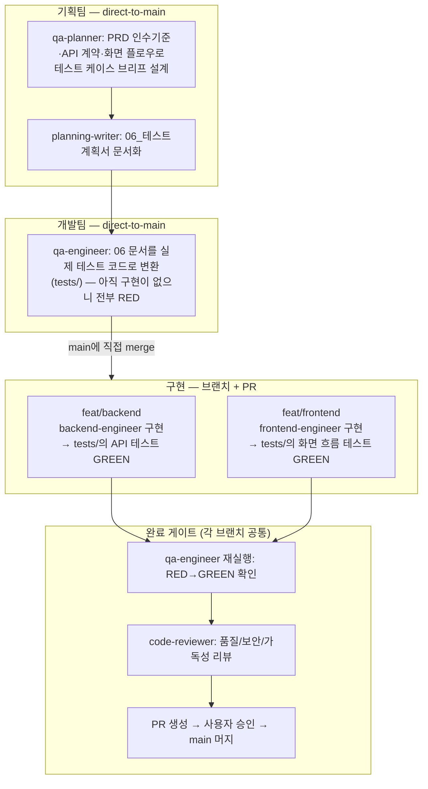

# Git 브랜치 전략 — 무엇을 direct-to-main으로, 무엇을 PR로

이 문서는 이 프로젝트에서 확립한 git 브랜치·머지 규칙을 정리한다. 절차만 담겨 있고 프로젝트 고유 데이터(폴더 이름 등)는 예시일 뿐이므로, 새 프로젝트에서도 그대로 재사용할 수 있다(포터블 — `docs/harness/reset-checklist.md` A그룹).

## 0. 대전제 — git 실행 권한은 메인 세션(사용자와 직접 대화하는 Claude)에만 있다

dev-team의 어떤 서브에이전트(backend-engineer/frontend-engineer/qa-engineer/dev-pl)도 git commit/push/PR/merge를 직접 실행하지 않는다. 이들의 Bash 접근은 로컬 실행·테스트용으로 한정된다. 브랜치 생성, 커밋, 푸시, PR 생성·머지는 메인 세션이 사용자의 명시적 확인을 받은 뒤에만 수행한다 — 단, `harness` 브랜치 → `origin` push는 `CLAUDE.md` "금지" 절의 명시적 예외(이미 반복적으로 확립된 고정 채널)에 해당해 매번 재확인하지 않는다(2026-08-22 명시, 1-1번의 push 절차 참고).

## 1. 세 갈래 규칙 — "구현 코드"는 PR 게이트, "하네스"는 전용 브랜치, 나머지는 direct-to-main

| 대상 | 머지 방식 | 이유 |
|---|---|---|
| 실제 구현 코드(예: `backend/`, `static/` — 프로젝트마다 TRD가 정한 실제 코드 폴더) | 브랜치 + PR + code-reviewer 리뷰 + 사용자 승인 | TDD 완료 게이트(qa-engineer 통과 + code-reviewer 리뷰)를 거친 하나의 완결된 작업 단위를 diff로 모아 검토하는 데 의미가 있다 |
| 하네스 정의(`.claude/agents/**`, `docs/harness/**` — `reset-checklist.md` A그룹 전체) | `harness` 전용 브랜치에 커밋 → `origin`에만 push (`main`·`assignment`엔 안 감, 2026-08-20 신설) | `main`은 `assignment`(과제 제출 저장소)가 최종적으로 받는 브랜치다. 재사용 템플릿 자산인 하네스가 거기 섞이면 "이 프로젝트가 실제로 제출한 것"과 "여러 프로젝트가 공유하는 하네스"의 경계가 흐려진다. 자세한 운용은 아래 1-1번 참고 |
| 그 외 전부 — 기획 문서(`docs/planning/**`), 디자인 산출물(`docs/design/**`), 루트/팀별 `CLAUDE.md`의 프로젝트 고유 섹션, 테스트 스캐폴딩(`tests/`) | main에 직접 커밋·푸시(기존처럼 대화 중 사용자가 그때그때 확인) | 이미 대화창에서 사용자가 각 변경을 실시간으로 확인·승인하는 구조라, 별도 PR 리뷰 단계를 끼우면 같은 검토를 두 번 하는 것일 뿐 — 반복적인 소규모 수정의 흐름을 오히려 늦춘다 |

**판단 기준**: 먼저 "하네스 정의인가?"(`.claude/agents/**`·`docs/harness/**`류)를 가른다 — 맞다면 `harness` 브랜치. 아니라면 "TDD red→green 사이클을 거친 실제 애플리케이션 코드인가?"로 나머지 두 갈래를 가른다 — 맞으면 PR 브랜치, 아니면 direct-to-main.

## 1-1. `harness` 브랜치 운용 — worktree로 main을 하네스로부터 격리한다

`main`이 하네스 커밋을 받으면, `assignment`로 push할 때마다 과제 제출물에 재사용 템플릿 자산이 섞여 들어간다. 이를 막기 위해 하네스 전용 롱리브드 브랜치 `harness`를 두되, **이 프로젝트 폴더 자체에서 `git checkout`으로 브랜치를 오가지 않는다** — 대신 별도 물리 폴더(worktree)를 하나 더 두고, 그 폴더에서만 `harness` 브랜치를 편집·커밋한다(2026-08-20, 아래 배경 참고).

**왜 checkout 대신 worktree인가**: 이 프로젝트 폴더에서 `git checkout harness` ↔ `git checkout main`을 오가면, 전환되는 그 순간 `main`엔 없고 `harness`에만 있는(또는 그 반대) 파일이 디스크에서 사라지거나 되돌아가 보인다 — 실제로 이런 사고가 있었다. 게다가 `.claude/agents/**`·`docs/harness/**`는 Claude Code가 **지금 서 있는 폴더**를 기준으로 실시간으로 읽는 파일이라, 이 폴더가 잠깐이라도 그 파일들을 잃으면 그 순간 서브에이전트 호출·CLAUDE.md `@`참조가 깨진다. worktree를 쓰면 이 프로젝트 폴더는 **`main`에서 영원히 벗어나지 않으므로** 이 문제 자체가 구조적으로 생기지 않는다.

- **worktree 생성(최초 1회)**: `git worktree add ../{프로젝트 폴더명}-harness-work harness` — 같은 `.git` 이력을 공유하는 형제 폴더가 생기고, 거기는 `harness` 브랜치가 고정 체크아웃돼 있다. 네이밍은 `{프로젝트 폴더명}-harness-work`로 통일한다(여러 프로젝트에 이 하네스가 흩어져 있어도 폴더 목록만 보고 바로 알아볼 수 있게).
- **역할 분리**:
  - **worktree 폴더(`{프로젝트}-harness-work`)** — 하네스(`reset-checklist.md` A그룹: `.claude/agents/*.md`, `.claude/skills/*/SKILL.md`, `.claude/commands/*.md`, `docs/harness/**`)를 **편집·생성·커밋하는 유일한 곳**이다. Edit/Write 도구도 이 경로를 직접 대상으로 쓰고, `git add`·`commit`·`push origin harness`도 여기서(`git -C {worktree 경로} ...`) 실행한다.
  - **이 프로젝트 폴더(main)** — 하네스 파일이 물리적으로 존재하긴 하지만 **읽기 전용 동기화 사본**이다. 여기서 하네스 파일을 직접 Edit/Write로 고치지 않는다. Claude Code가 정상 작동하려면(서브에이전트 호출, CLAUDE.md `@`참조) 이 사본이 최신이어야 하므로 항상 최신으로 유지하되, 방법은 커밋이 아니라 "받아오기"다.
- **동기화(받아오기) 절차**: worktree에서 커밋을 마치면, 이 프로젝트 폴더로 돌아와 `git checkout harness -- .claude docs/harness`로 해당 경로만 복사해온다(브랜치 전체 전환이 아니라 경로 지정 checkout이라 `main`의 체크아웃 상태 자체는 안 바뀐다). 이렇게 받아온 파일은 **`main`에 절대 커밋하지 않는다** — `git status`에 계속 "modified"로 남는 게 정상이고, 의도된 상태다.
- **동기화는 언제, 누가 하나(자동/실시간 아님) — 절대 빠뜨리면 안 되는 단계**: worktree와 이 프로젝트 폴더는 파일시스템으로 서로 감시하거나 자동 동기화되는 관계가 아니다 — git 커밋 이력으로만 연결된 별개의 두 폴더라, 위 동기화 절차를 누군가 실제로 실행해야만 반영된다.
  - **"worktree에서 커밋" + "이 폴더에서 동기화"는 하나로 묶인 한 세트다** — 메인 세션이 worktree에서 하네스를 커밋했으면, 그 턴 안에서 곧바로 동기화까지 마치고 나서야 그 작업이 끝난 것으로 친다. 커밋만 하고 동기화를 다음으로 미루거나 잊는 것을 절대 허용하지 않는다 — 사용자가 매번 알려줄 필요 없음.
  - **왜 훅으로 자동화하지 않았는가(2026-08-20 검토·기각)**: PostToolUse 훅은 Bash 명령이 어느 cwd에서 실행됐는지 구조적으로 알 수 없어(Bash 도구 입력에 cwd 필드 자체가 없음), 명령어 문자열에 worktree 경로가 포함돼 있는지 grep으로 추측하는 수밖에 없다 — 표현이 조금만 달라져도(`cd`로 이동 후 커밋 등) 조용히 안 걸리는 매칭이라, "자동화됐으니 안 챙겨도 된다"는 잘못된 안심을 준다. 그래서 자동화 대신 이 문서에 명시된 절차를 메인 세션이 매번 직접 수행하는 쪽을 택했다 — 다음에 또 훅을 검토할 필요 없음.
  - 하네스가 다른 경로로 바뀌었을 가능성이 있을 때(다른 세션이 손댔거나, 사용자가 worktree 폴더를 직접 고친 경우): 메인 세션이 자동으로 알 방법이 없으므로, 하네스 관련 작업을 시작하기 전에 먼저 최신 상태인지 확인하는 습관을 들인다(`git -C {worktree 경로} log -1` 등으로 비교). 확실히 하려면 사용자가 미리 알려주는 것도 안전하다.
- **주의 — `EnterWorktree`/`ExitWorktree` 도구는 쓰지 않는다**: 이 도구들은 "세션의 작업 디렉토리 자체"를 그 worktree로 전환하고 CWD 기준 캐시(CLAUDE.md·메모리 등)를 다시 로드한다 — 그러면 세션이 참조하는 설정이 worktree 폴더 기준으로 바뀌어 버려, 정작 이 세션이 하네스를 쓸 수 없게 되는 역효과가 난다. 대신 그냥 Bash로 `git -C {worktree 경로} ...`처럼 경로를 지정해 실행한다 — 세션 자체는 항상 이 프로젝트 폴더에 고정된 채로 유지된다.
- **push 대상**: `harness` 브랜치는 `origin`에만 push한다(`git push origin harness`, worktree에서 실행). `assignment`로는 push하지 않는다 — `assignment`는 오직 `main`만 받는다. 이 `harness`→`origin` push는 `CLAUDE.md` "금지" 절의 예외에 해당해 매번 재확인 없이 진행한다 — 다른 모든 push(`assignment`, `main`→`assignment`/`origin`)는 여전히 매번 명시적 확인이 필요하다.
- **`main`을 A그룹 추적에서 완전히 제외한다(2026-08-22)**: `main`의 `.gitignore`에 `.claude/agents/`·`.claude/skills/`·`.claude/commands/`·`.claude/hooks/stop-failure-notify.sh`·`docs/harness/`를 추가하고, `git rm --cached`로 기존에 커밋돼 있던 것도 인덱스에서 뺐다. **`main`의 작업 디렉토리에서 파일 자체를 삭제하는 것은 하지 않는다** — Claude Code가 이 폴더를 기준으로 서브에이전트·CLAUDE.md `@`참조를 실시간으로 읽으므로, 파일이 없으면 하네스 전체가 이 폴더에서 작동하지 않게 된다. `git rm --cached`는 git 인덱스에서만 빼고 디스크의 파일은 그대로 남기므로 이 요구사항과 양립한다 — 이제 `main`은 이 경로들에 대해 앞으로 무슨 일이 있어도 새 커밋이 안 쌓인다(가장 확실한 격리).
- **이미 과거 커밋에 남아있는 하네스 이력**(assignment/origin의 `main`에 예전부터 섞여 들어간 것)은 위 조치로는 안 지워진다 — 그건 `git filter-repo`로 커밋 해시 자체를 새로 쓰는 훨씬 무거운 작업(강제 push 필요)이라, 사용자가 명시적으로 요청할 때만 별도로 진행한다.
- 다른 프로젝트로 하네스를 포크할 때는 `origin`의 `main`이 아니라 `harness` 브랜치를 기준으로 삼는다 — 자세한 건 `docs/harness/harness-versioning.md` 참고.

## 1-2. `harness` 브랜치에서 `.claude/agent-memory/`를 제외한다

`harness` 브랜치는 최초에 `main`에서 분기했기 때문에, 분기 시점에 `main`이 갖고 있던 `.claude/agent-memory/*.md`(에이전트별 최근 작업 로그 — 이 프로젝트의 실제 세션 이력, `reset-checklist.md` B그룹)도 그대로 딸려 들어와 있다. 이건 하네스(A그룹)가 아니라 이 프로젝트 고유 데이터라, `harness` 브랜치에 남아있으면 안 된다 — origin(JY_Harness, 하네스 허브)에 세션 이력이 실수로 섞여 들어갈 위험이 생긴다(과거에 실제로 겪은 사고, `feedback_origin_push_full_history` 메모리 참고).

- **worktree(`{프로젝트}-harness-work`)의 `.gitignore`에 `.claude/agent-memory/`를 추가한다** — 이건 `main`의 `.gitignore`와 의도적으로 다르다(`main`은 agent-memory를 계속 정상 추적해야 하는 프로젝트 데이터로 취급하고, `harness` 브랜치만 이를 제외한다). 두 브랜치의 `.gitignore`가 이 지점에서 갈라지는 건 실수가 아니라 설계다.
- `git rm --cached -r .claude/agent-memory`로 harness 브랜치의 기존 추적을 끊는다(파일은 worktree 디스크에 그대로 남는다 — 어차피 그 worktree는 하네스 편집 전용이라 이 파일들을 실제로 쓸 일이 없다).
- **다른 프로젝트로 하네스를 포크할 때도 같은 원칙**: `.claude/agent-memory/`의 실제 로그 내용은 이식하지 않고, 새 프로젝트에서 각 에이전트가 처음 실행될 때 알아서 새로 채우도록 빈 상태로 시작한다 — `reset-checklist.md` B그룹의 "내용은 비우거나 신설 상태로 리셋" 규칙과 같은 방향이다.

## 2. 브랜치는 폴더를 "잠그지" 않는다 — 분리는 두 가지 규율로 만든다

git 브랜치는 프로젝트 전체의 스냅샷이다. 특정 브랜치가 특정 폴더만 건드리게 되는 건 git이 강제해서가 아니라 아래 두 규율이 함께 작동하기 때문이다:

1. **작업 지시 범위**: 해당 브랜치에서 호출하는 에이전트(예: backend-engineer)의 지시 자체가 자기 폴더(`backend/`)만 다루도록 한정돼 있다 — 다른 폴더를 만질 이유 자체가 주어지지 않는다.
2. **커밋 시 파일 선별**: 메인 세션이 `git add {폴더}/...`처럼 그 브랜치에 속하는 파일만 골라 스테이징한다.

이 두 겹의 규율 때문에, 서로 다른 팀이 서로 다른 폴더를 병렬로 작업해도 실질적으로 충돌이 나지 않는다.

## 3. 병렬 구현 폴더가 겹치지 않으면 브랜치 충돌도 없다

이 프로젝트는 TRD가 확정한 파일 구조 자체가 팀별로 분리돼 있다(예: `backend/` ↔ `static/`, 서로 다른 팀이 서로 다른 폴더를 씀, 파일 하나도 안 겹침). 이 구조 덕분에 두 구현 브랜치를 어느 순서로 머지해도 충돌이 발생하지 않는다 — 각자 자기 폴더에 새 파일을 추가하는 것뿐이라 git이 "합치는" 작업이 기계적으로 끝난다.

새 프로젝트에서 이 이점을 그대로 누리려면, tech-architect가 파일 구조를 설계하는 단계에서부터 팀별 담당 폴더가 겹치지 않도록 미리 분리해두는 것이 중요하다(`.claude/agents/tech-architect.md` 판단 기준 참고).

## 4. TDD와 브랜치 분기 시점 — 공유 테스트 스캐폴딩을 먼저 main에 흡수한다

구현 코드 브랜치가 갈라지기 **전에** 테스트 스캐폴딩이 먼저 완성돼 있어야, 두 구현 브랜치 어느 쪽도 테스트 코드 자체를 건드릴 필요가 없어진다(테스트 파일까지 여러 브랜치가 손대기 시작하면 충돌 지점이 생긴다).

## 5. 완료 게이트 순서 요약

1. `feat/{team}` 브랜치에서 구현 완료
2. qa-engineer가 `tests/`를 재실행해 RED→GREEN 확인 (실패하면 구현으로 돌아감)
3. code-reviewer가 diff를 정적 리뷰
4. 메인 세션이 PR을 생성하고, 사용자에게 diff를 보여준 뒤 명시적 승인을 받는다
5. 승인 후에만 메인 세션이 머지를 실행한다 — 이 단계도 dev-team 에이전트가 아니라 메인 세션의 몫이다

## 6. 하네스 라운드 종료 시 자동 감사

`.claude/agents/**`·`.claude/skills/**`·`docs/harness/**` 중 하나라도 추가·수정하는 작업 라운드가 끝나면, 사용자에게 실행 여부를 묻지 않고 바로 `harness-auditor`를 실행한다(2026-08-22 신설 — CLAUDE.md "행동 지침"에도 같은 규칙이 있다). 이전엔 매번 "지금 감사할까요?"로 판단해 왔는데, 하네스를 고친 라운드 뒤에는 사실상 항상 감사가 필요했으므로 판단 자체를 없앤다.

**자동인 것은 "감사 실행"뿐이다** — harness-auditor는 원래 설계대로 문제를 발견만 하고 직접 고치지 않는다(read-only). 감사가 찾은 문제를 실제로 수정할지는 그 결과를 사용자에게 보고한 뒤 확인받는다. 예외로, `document-versioning-guide.md`가 명시하는 **"기계적 버전 번호 동기화"**(다른 문서가 최신 버전을 인용하지 못하고 있는 것을 실제 최신 버전 문자열로 맞추는 것, 판단이 필요 없는 단순 치환) 하나만은 harness-auditor가 발견 즉시 그 자리에서 고쳐도 된다 — 이 항목이 여러 문서에 걸쳐 5회 넘게 반복된 패턴이라 예외를 둔다(`document-versioning-guide.md` 참고). 그 외의 발견(구조적 공백, 정의 모순 등 판단이 필요한 것)은 전부 기존 방식(보고 → 확인 → 수정)을 따른다.
