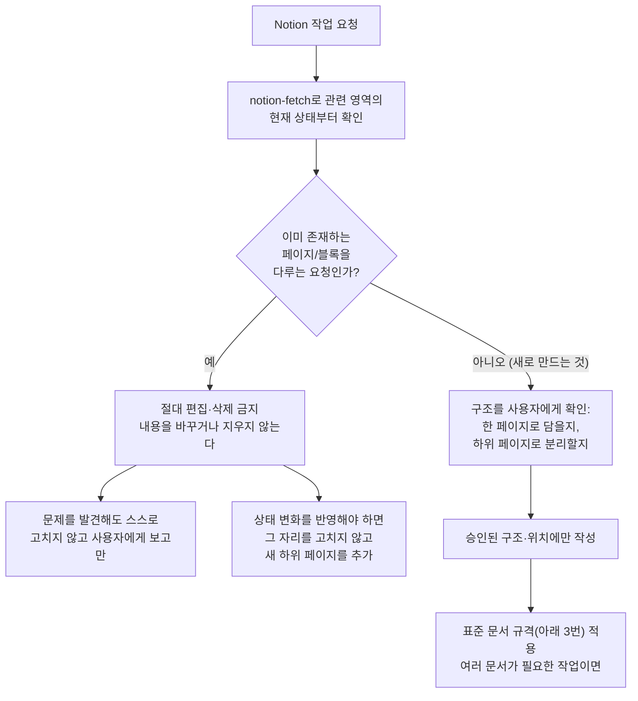
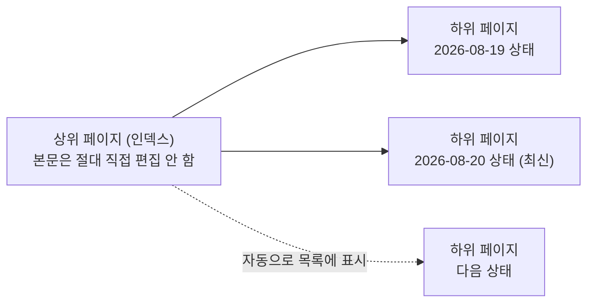
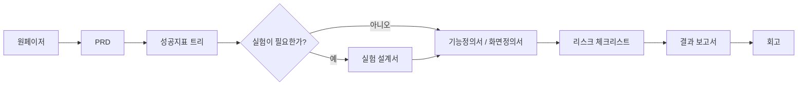

# Notion 작성/관리 워크플로우

## 배경

Notion은 완성된 보고서 산출물(Word/PPT/HTML로 별도 제작)을 두는 곳이 아니라, **프로젝트를 관리(계획·추적)하는 용도**로 쓴다. MCP로 연결해 작업할 때, 이미 존재하던 글이나 문서를 실수로 고치거나 지우면 안 된다. 이 문서는 그 원칙을 여러 프로젝트에서 재사용 가능한 절차로 정리한다(포터블 — `reset-checklist.md` A그룹).

**이 문서의 시각적 구성·서식 규칙(5절 등)을 세세하게 지키는 이유(2026-08-22 명시)**: "관리 문서냐 완성 보고서냐"(위 문단, 6절)와는 별개의 축으로, **"이걸 나 혼자만 보느냐, 다른 사람도 보게 되느냐"**라는 문제가 있다. 이 프로젝트 관리용 Notion 페이지는 완성 보고서가 아니지만, 그렇다고 항상 "나 혼자 보는 작업 메모"로 끝난다는 보장도 없다 — 평가자가 진행 상황을 확인하러 그대로 열어볼 수도 있고, 팀원과 공유하는 문서가 될 수도 있다. 그러니 서식 품질은 "깔끔하면 좋은 것" 수준의 선택사항이 아니라, 언제 다른 사람이 그대로 볼 수도 있다는 전제 위의 필수 기준이다. 회색 글자 남용 금지, 목록 흐름을 끊지 않는 배치, 명목화된 문장 구성 같은 세부 규칙들은 전부 이 전제에서 나온다.

## 절대 규칙 — 기존 콘텐츠는 절대 수정·삭제하지 않는다, 새 내용은 항상 추가만 한다

예외 없음. 이미 존재하는 페이지·블록(사용자가 직접 썼든, Claude가 예전에 만들었든 상관없이)은 **절대 편집·삭제하지 않는다.** 진행 상황이 바뀌어 "갱신"이 필요한 상황에서도 기존 내용을 고치는 게 아니라, 언제나 **새 페이지(또는 새 하위 페이지)를 추가**하는 방식으로 처리한다.

## 1. 작업 전 절차

1. **`notion-fetch`로 대상 영역의 현재 상태부터 확인한다** — 무엇이 이미 있는지 모른 채로 쓰기 시작하지 않는다.
2. **구조를 사용자에게 확인한다**: 이번 내용이 한 페이지에 다 담기면 되는지, 아니면 하위 페이지로 나눠야 하는지(예: 문서 종류가 여러 개거나 내용이 길 때) — 짐작해서 임의로 정하지 않는다.
3. **승인된 위치에만 작성한다.** 부모 페이지가 아직 정해지지 않았으면 작업을 시작하기 전에 반드시 먼저 물어본다 — 어울릴 것 같은 위치를 짐작해서 만들지 않는다(Figma 작업의 "새 파일 임의 생성 금지, 먼저 작업할 파일 링크부터 물어본다" 원칙과 같은 이유).

## 2. 진행 상황이 바뀌어 "갱신"이 필요한 경우 — 새 하위 페이지 추가로 처리한다

프로젝트 관리용 페이지(계획, 상태, 진행 로그 등)를 계속 최신으로 유지해야 하더라도, 그 페이지의 본문을 직접 고치지 않는다. 대신 그 페이지를 **인덱스 역할**로 두고, 상태가 바뀔 때마다 **새 하위 페이지**를 추가한다 — Notion의 하위 페이지 구조는 자식 페이지를 만들면 자동으로 상위 페이지에 나타나므로, 상위 페이지의 본문 블록을 수동으로 편집할 필요가 없다.

## 3. 표준 문서 규격 — 문서 종류와 순서

기획/제품 관리 성격의 작업을 Notion에 쌓아갈 때는, 특별히 다른 순서를 요구받지 않는 한 아래 순서를 기본값으로 따른다. 각 단계는 별도 페이지로 만든다(위 "하위 페이지로 분리" 원칙과 연결). 여기서 말하는 각 문서는 프로젝트를 관리하기 위한 작업 문서이지, Word/PPT/HTML로 별도 제작되는 완성 보고서를 대체하는 게 아니다.

- **원페이저**: 무엇을·왜 하는지 한 페이지로 요약.
- **PRD**: 요구사항을 구체화.
- **성공지표 트리**: 무엇으로 성공을 판단할지, 상위 지표부터 하위 지표까지 구조화.
- **실험 설계서**: A/B 테스트 등 실험이 필요한 경우에만 — 필요 없으면 건너뛴다.
- **기능정의서 / 화면정의서**: 실제로 무엇을 만들지 정의.
- **리스크 체크리스트**: 진행 전에 놓치기 쉬운 위험 요소 점검.
- **결과 보고서**: 실행 후 실제로 어떻게 됐는지 관리용으로 정리한 요약(완성 보고서 산출물과는 별개).
- **회고**: 다음에 반복하지 않을 교훈 정리.

이미 앞 단계 문서가 있는데 뒷 단계로 건너뛰라는 요청이 오면, 앞 단계가 실제로 존재하는지(로컬 `docs/planning/**` 등에 대응 문서가 있는지) 먼저 확인하고 없으면 사용자에게 알린다 — 있는데 형식만 Notion으로 옮기는 것뿐이면 그대로 옮긴다.

### 3-1. 작성 워크플로우 — 로컬 초안 → 점검 → Notion

위 문서들은 곧바로 Notion에 쓰지 않고 다음 순서를 따른다: **데스크리서치**(내부 근거 — 과제 스펙·기존 기록·하네스 문서, 외부 근거 — 실무 사례·관련 자료. 승인 없이 자율 수행) → **로컬 초안 작성**(`docs/planning/`에 마크다운으로) → **Notion에 올리기 전 오타·"AI 티" 점검**(상투적 어구, 기계적으로 균일한 문장 길이, 과잉 구조화, 근거 없는 헤징, 스마트따옴표·em dash 남용 등 — 이 체크리스트는 여기서 새로 정의하지 않고 `report-format-guide.md` 9절 "최종 QA — AI 티 제거"를 정본으로 참조한다) → **Notion 하위 페이지로 복사**(1번 절차대로 위치 확인) → **사용자가 Notion에서 직접 다듬음** → **버전업**(로컬 파일도 같이 버전을 올리고 구버전은 `old/`로 이동, 이 버전업이 다른 문서의 인용에 영향을 주면 함께 갱신).

### 3-2. 작성 스타일 — 결론 먼저, 설명은 그 아래

섹션·문단은 질문형이나 배경 설명으로 한참 돌다 결론에 도달하는 구성을 피한다. 첫 문장에 핵심 주장을 굵게 명목화해서 먼저 던지고, 그 아래에 근거·설명을 풀어쓴다. 예: "이 프로젝트는 무엇을 하려는가?"처럼 질문으로 시작하거나 배경부터 주저리 서술하지 않고, "이 프로젝트는 두 트랙을 하나의 포트폴리오로 엮는다 — A와 B."처럼 결론을 굵은 한 문장으로 먼저 던진 뒤 그 아래에 세부 설명을 풀어쓴다.

### 3-3. 문서 상단 메타 표·스코프 콜아웃 + 맨 끝 "근거" 절

문서 상단에 메타 표(문서유형/버전/상태)와 "이 문서가 다루는 것/다루지 않는 것" 콜아웃을 두는 원칙은 `docs/harness/planning-team/document-structure-guide.md`를 그대로 따른다(중복 정의하지 않음) — 단, 그 문서의 원래 조건 그대로 **참고할 기존 문서가 있으면 그 구조를 우선**하고, 메타 표+콜아웃은 선례가 전혀 없는 백지 상태에서 쓰는 기본값이다. 여기에 더해, **문서 맨 끝에 "근거" 절**을 둔다 — 이 문서의 주장·수치가 어디서 왔는지(다른 계획 문서와 그 버전, 외부 자료, 직접 실행한 검증 등) 인용 목록을 남겨, 나중에 어느 문서를 봐야 재확인할 수 있는지 추적 가능하게 한다.

### 3-4. Notion 마크다운 작성 시 기술적 함정

- **표 셀 등 아무 데서나 `<strong>`같은 HTML 태그를 쓰면 렌더링되지 않고 글자 그대로 노출(leak)된다** — 어디서든 강조는 마크다운(`**텍스트**`)만 쓴다. 표 셀 안이라고 예외가 아니다.
- **`<`·`>`·`&`를 HTML 엔티티(`&lt;` 등)로 이스케이프해서 쓰지 않는다** — Notion이 디코딩하지 않고 그대로 노출한다. 그 문자가 필요하면 이스케이프 없이 그대로 쓴다.
- `<table>`/`<tr>`/`<td>`, `<page url="...">`, `<database url="...">`, `<callout>`, `
`(토글), 그리고 인라인 서식용 ``(색상)·``(밑줄)처럼 Notion 자체의 "Enhanced Markdown" 스펙(`notion://docs/enhanced-markdown-spec`)에 정의된 태그는 그대로 써도 된다 — 이것들은 leak되는 raw HTML이 아니라 Notion 마크다운 문법 그 자체다. 금지되는 건 이 스펙에 없는 태그(`<strong>`/`<b>`/`<em>` 등 일반 HTML 서식 태그)뿐이다 — 예를 들어 굵게는 `<strong>`이 아니라 `**텍스트**`, 표 셀 안의 굵게도 마찬가지로 마크다운만 쓴다.
- `update_content`/`create_pages`로 표를 작성·수정한 뒤엔 **반드시 `notion-fetch`로 다시 읽어 실제 렌더링 결과를 확인한다** — 호출이 에러 없이 성공했다고 의도한 서식대로 보인다는 보장은 없다.
- 굵게(`**텍스트**`)를 인라인 코드(`` `코드` ``) 위에 걸쳐서 쓰지 않는다 — 코드 스팬 앞에서 굵게를 닫고, 필요하면 코드 스팬 뒤에서 새로 연다.
- **한글을 `\uXXXX` 유니코드 이스케이프로 손수 계산해서 타이핑하지 않는다** — 도구 호출 파라미터에 한글을 리터럴 UTF-8 그대로 적는다(코드포인트를 손으로 변환하면 자모가 미묘하게 틀린 다른 글자가 되기 쉽다). 수정 직후 `notion-fetch`로 재확인한다. 같은 오타 수정이 "no matches found"로 두 번 이상 실패하면, 오류 메시지가 되돌려주는 문자열을 그대로 복사해 재시도하거나, 그래도 안 되면 부분 교체 대신 본문 전체를 새로 쓰는 방식으로 전환한다.

## 4. 새 프로젝트를 시작할 때 — 로컬 파일보다 Notion 확인이 먼저

새 프로젝트에서 기획/문서 작업을 시작하기 전에, 로컬 `docs/planning/**` 등을 먼저 채우기 시작하지 않고 **그 프로젝트에 이미 대응하는 Notion 페이지가 있는지부터 확인한다** — 사용자가 이미 Notion에서 관리를 시작해뒀는데 로컬에 새로 처음부터 만들면 두 곳이 어긋난 상태로 남는다. 있으면 그 내용을 출발점으로 삼고(위 "절대 편집 금지" 원칙에 따라 그 페이지 자체는 건드리지 않고 내용만 참고), 없으면 사용자에게 "Notion에 이 프로젝트용 관리 페이지를 새로 만들지" 물어본다.

## 5. 페이지를 시각적으로 잘 구성한다

새 페이지를 텍스트만 쭉 나열한 문서로 만들지 않는다 — 사용자 본인은 물론 다른 사람이 봐도 한눈에 구조가 들어오게, Notion이 기본 제공하는 서식 요소를 적극 활용한다.

- **다이어그램/시각 자료는 예외가 아니라 기본 전제다**: 흐름·구조·관계(절차, 의사결정 분기, 계층 구조, 타임라인 등)를 설명해야 하면 줄글로 풀어쓰기보다 다이어그램으로 먼저 표현하는 걸 기본으로 삼는다 — Notion 코드 블록은 mermaid를 지원하므로 mermaid 플로우차트/시퀀스/간트 등을 적극 쓴다. "필요하면 그림 하나쯤 넣는다"가 아니라 "구조가 있는 내용이면 그림부터 그리고 텍스트는 보조로 붙인다"는 순서로 접근한다.
- **아이콘**: 페이지 성격을 나타내는 이모지 아이콘을 페이지 제목에 붙인다 — 같은 인덱스 아래 하위 페이지가 여러 개 쌓일 때(위 2번) 아이콘만 보고도 종류를 구분할 수 있게 한다.
- **헤더·구분선**: 긴 내용을 헤더(H1/H2/H3)와 구분선(divider)으로 섹션을 나눈다 — 하나의 큰 문단 덩어리로 두지 않는다.
- **콜아웃 블록**: 결론·주의사항·핵심 요약처럼 먼저 눈에 띄어야 할 내용은 콜아웃 블록으로 강조한다.
- **토글 블록**: 세부 근거·부가 설명처럼 필요할 때만 펼쳐보면 되는 내용은 토글로 접어둬서 본문을 스캔하기 쉽게 유지한다.
- **회색 글자 — Claude 자신이 참고하려고 남기는 절차 설명은 비강조로 구분한다(2026-08-22 신설)**: 사용자가 실제로 읽고 판단해야 하는 내용과, Claude가 나중에 이 페이지를 다시 참고할 때 쓰려고 남기는 절차적 설명(예: "이 값은 이런 규칙으로 자동 갱신된다")을 시각적으로 구분한다. 후자는 `텍스트`로 감싸 본문보다 눈에 덜 띄게 한다(예: 진행보드 DB 옆의 상태 갱신 규칙 설명). **단, 이걸 남용하지 않는다** — 페이지가 회색 글자투성이가 되면 오히려 뭐가 중요한지 안 보이게 된다. 사용자가 실제로 읽어야 할 결정·결과·핵심 서술은 절대 회색으로 만들지 않고, "이건 순전히 Claude가 나중에 참고하려는 절차 설명"인 것만 좁게 골라 회색으로 표시한다 — 애매하면 회색으로 만들지 않는다. **위치도 중요하다 — 여러 항목이 나열된 목록(불릿 리스트) 안에 회색 항목을 한 줄로 끼워 넣지 않는다.** 목록의 다른 항목들과 나란히 하나의 항목처럼 섞이면, 그 목록을 훑어 읽는 흐름이 끊긴다 — 이런 경우 회색으로 남길 내용은 목록이 끝난 뒤 맨 아래에 별도 문단으로 뺀다. 반면 위 진행보드 예시처럼 **참조 대상(표·DB·다이어그램) 바로 뒤에 독립된 문단 하나로 붙는 것**은 목록을 끊는 게 아니므로 이 제약의 대상이 아니다 — 이 규칙이 막는 건 "나열된 항목들 사이에 섞여 들어가는 것"이지 "설명 대상 바로 옆에 붙는 것" 자체가 아니다.
- **문서의 "변경 이력"/버전 기록 절은 콜아웃이 아니라 토글로 감싼다(2026-08-22 신설)**: 로컬 문서를 Notion으로 옮길 때, 상단에 쌓여 있는 버전별 변경 이력을 콜아웃이나 평문으로 그대로 노출하지 않는다 — 버전이 늘어날수록(실제로 v1.14까지 쌓인 문서도 있다) 그 절 하나가 문서 상단을 다 차지해서 정작 본문 내용을 보기 어렵게 만든다. **"버전 기록" 토글 하나로 감싸고**, 그 안에 버전별 항목을 목록으로 넣는다 — 평소엔 접혀 있어 본문이 바로 보이고, 이전 버전 내용이 궁금할 때만 펼쳐본다.
- **표/데이터베이스**: 반복되는 항목(체크리스트, 지표, 비교표 등)은 일반 텍스트 나열 대신 표나 데이터베이스로 구조화한다(위 "3. 표준 문서 규격"의 리스크 체크리스트·성공지표 트리 등에 특히 해당).
- **핵심이 아닌 방대한 내용은 본문에 늘어놓지 않고 하위 페이지·데이터베이스로 뺀다**: 지금 보는 페이지에서 바로 중요한 결론·현재 상태만 한눈에 들어오게 하고, 그걸 뒷받침하는 세부 목록(예: 원재료 상세, 개별 항목별 로그, 참고 자료 모음처럼 양은 많지만 지금 당장 다 읽을 필요는 없는 내용)은 하위 페이지로 분리하거나 데이터베이스(필터·정렬·보기 전환이 되는)로 만들어 링크만 남긴다 — 토글로 접는 것보다 한 단계 더 나아가, 아예 페이지를 분리해야 할 만큼 방대하면 주저하지 않고 분리한다.
- 이 기본값이 사용자가 이미 써온 페이지의 기존 형식과 안 맞으면, 형식 통일보다 "기존 문서와 안 어긋나는 것"을 우선한다(위 "절대 편집 금지" 원칙과 같은 이유 — 새로 만드는 페이지도 그 주변 페이지들과 스타일이 크게 튀지 않게 한다).

## 6. 완성된 보고서와의 관계

`docs/test-reports/`처럼 로컬에 쌓이는 완성 보고서(단위/통합 테스트 보고서 등), 그리고 그걸 Word/PPT/HTML 등으로 별도 제작하는 작업은 이 문서의 대상이 아니다 — 그건 "보고서 산출물" 관리 규칙(프로젝트별 `CLAUDE.md`에 명시)이고, 이 문서는 그것과 무관하게 "Notion을 프로젝트 관리 용도로 어떻게 쓸지"만 다룬다. 특정 프로젝트가 보고서를 Notion에도 링크/게시하기로 정했다면, 그건 이 문서의 규칙이 아니라 그 프로젝트 고유의 별도 관례다.

## 7. 하네스 기록용 페이지는 "카탈로그"처럼 간결하게

`.claude/agents`·`docs/harness` 구조를 정리해두는 Notion 페이지는 위 3~5번의 프로젝트 기획 문서와 성격이 다르다 — "지금 하네스가 뭘로 구성돼 있는지"를 한눈에 훑어보는 카탈로그이지, 진행 중인 작업 문서가 아니다.

- **메인 페이지 = 지금 상태를 훑어보는 카탈로그.** "무엇이 있다"(에이전트 목록, 스킬 목록, 파일 목록)를 표로, 한 항목당 한 줄 설명으로 압축한다.
- "왜 이렇게 됐는지"·어떤 시행착오를 거쳤는지·특정 세션의 사건 경위는 메인 페이지에 쓰지 않는다 — 궁금한 사람만 열어보도록 하위 페이지로 분리하고, 메인엔 링크 한 줄과 결론 한 줄만 남긴다.
- 표는 짧게 — 설명 칸은 되도록 한 문장 이내. 여러 줄짜리 설명이 필요하면 표에 욱여넣지 말고 하위 페이지로 뺀다.
- 다이어그램도 핵심 흐름만 — 범례·주석·색상 분류가 다이어그램 자체보다 커지면 과하다는 신호다.
- **메인 페이지엔 날짜를 박지 않는다.** 이 페이지는 "지금 이 순간의 방향성·구조"를 계속 참고하는 카탈로그이지 변경 이력을 남기는 로그가 아니다 — "언제 바뀌었는지"는 git 커밋 이력이나 `harness-versioning.md`의 포크 로그가 이미 갖고 있으니 중복해서 남기지 않는다.
- 이 기준으로 다시 훑어봐도 좋을 신호: 메인 페이지의 어느 섹션이 스크롤 없이 한눈에 안 들어오면, 그 섹션 내용의 상당수가 하위 페이지로 빠져야 할 후보다.
